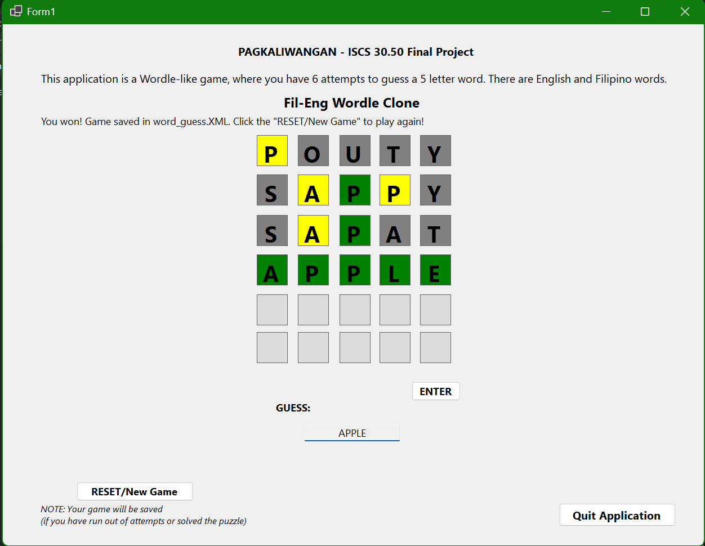
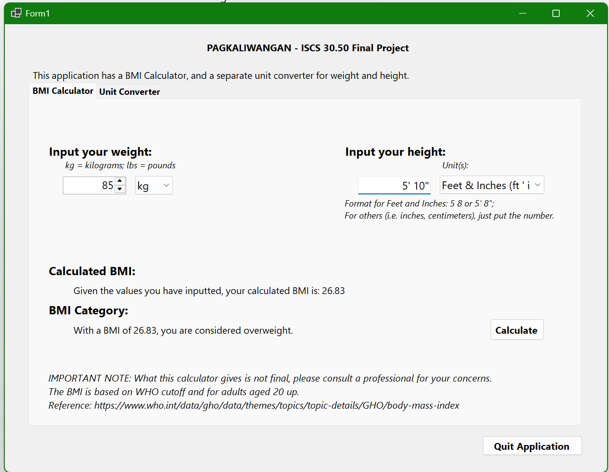
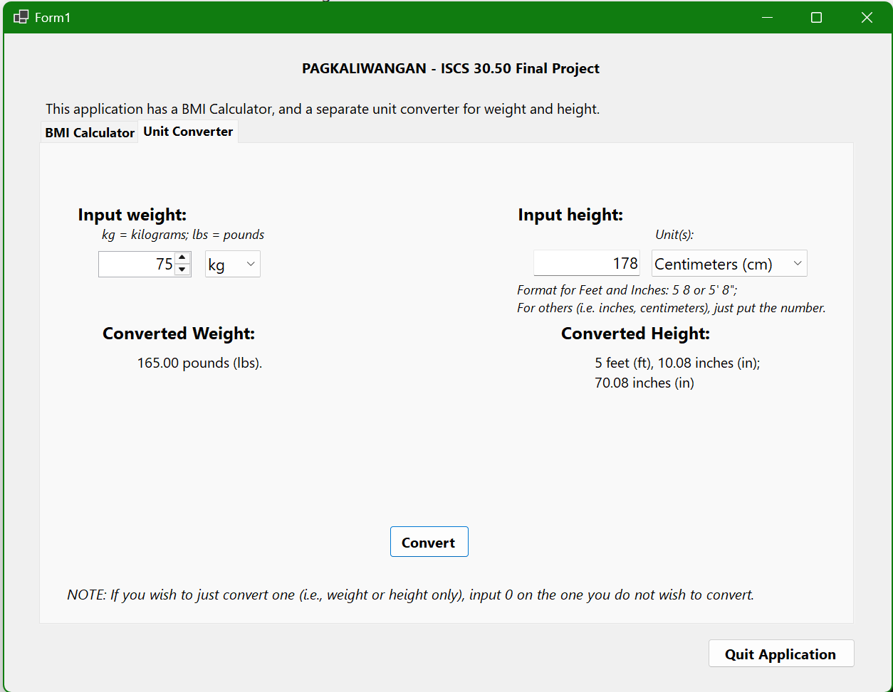

# Final Project for ISCS 30.50 - CM of S.Y. 2026-2027, SEM 1

By: Luis Andrei Pagkaliwangan, 3rd Year BS CS-DGDD (As of the making of this project)

## Approved Proposals

The proposals that were approved for this project are the Wordle-type game, and the BMI Calculator with additional converter feature.

### What will be in the main branch (the one to be submitted)?

I have decided to put both the BMI calculator and the Wordle game to be on the main branch. However, I submitted the Wordle game for my final project requirement. You may view the details regarding the projects under the [details about the project](#details-about-the-projects) section.

## Details About The Projects

The projects will be utilizing XML for data storage such as the number of guesses made and the guesses themselves, and the BMI of a person given their weight and height.

Additionally, Windows Forms (WinForms) will be utilized for the UI of the programs.

### For the **Wordle-Type Game**

This project is based on the New York Time's (NYT) Wordle

- So there will be a similar implementation where there is a keyboard or alphabet letters shown where if the letter is not in the word, it will be greyed out, if the letter is in the word but in the wrong position, it will be yellowed out or made orange, and if the letter is in the word and in the correct position, it will be made green.
- All guesses or attempts, and the number of guesses will be placed inside an XML file.
  - The corresponding word(s) to be guessed (per game) will also be placed inside the XML file.
  - But the words themselves will also be inside a program file, either as a list that will be accessed by a function, or the words will be inside the function itself.
- There will only be around 20-30 fixed words, and the word to be guessed (that will be placed inside the XML File) will be selected with a random number.

### For the **BMI Calculator**

- Both the input and the results of the BMI calculation will be saved in an XML file.
- The default units of measurement to be used for the calculator will be centimeters (cm) and kilograms (kg).
  - There may be a possible implementation of a unit converter that is relevant to BMI, the conversions being, kilograms to pounds (lbs.), cm to ft and inches, and vice versa. The inputs and results for the converter will not be included in the XML file.
- The chosen unit of measurements for the inputs of the BMI calculator will be either via dropdown or radio buttons where users can choose between kg and lbs. for weight, while for height, it’ll be via dropdown.
  - Considering that there is a unit converter as part of the project, the converter part may be in a different or separate tab of the Windows Form application (for UI cleanliness as well).
    - All of the posible input boxes will be on that tab, and those that are left empty will either be filled with the converted equivalents for those units or there will be a results subgroup in that tab, where the converted equivalents will be displayed.

### Image(s) of the Program(s)

1. Wordle-Type Game (Fil-Eng Wordle Clone)
    - 
2. BMI Calculator
    - 
    - 
